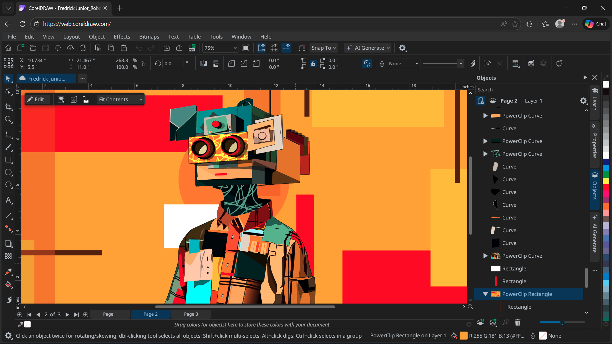

# Corel PHOTO-PAINT for Retouching and Image Compositing

Corel PHOTO-PAINT is a raster image editor included in CorelDRAW Graphics Suite.
It brings photo correction, object editing, masking, and painting into a visual workspace.

People searching for Coreldraw Photo Paint can use this guide to plan an editing workflow.
Corel Photo Paint combines photographic adjustments with tools for assembling image compositions.

[](https://coreldraw-photo-paint.github.io/Corel-Photo-Paint/)

This repository provides independent documentation and references to the supplied source snapshot.
The linked source files belong to GIMP, an open-source image editor used here for comparison.
They are not Corel source code, Corel configuration files, or a PHOTO-PAINT distribution.

## User Manual

A useful corel photo paint software workflow separates correction, selection, compositing, and delivery.
Decide what the image must communicate before applying effects or changing its dimensions.

| Editing task | Working approach | Review before delivery |
| --- | --- | --- |
| Exposure and tone | Correct the overall image before local changes | Preserve useful highlight and shadow detail |
| Subject isolation | Build a mask around the required subject | Inspect hair, transparent areas, and edge halos |
| Product retouching | Keep repairs separate from the source where practical | Check repeated texture and inconsistent reflections |
| Image compositing | Organize independent elements as objects | Compare perspective, scale, lighting, and contact shadows |
| Decorative painting | Select brushes and colors for the intended surface | Inspect transitions at the final viewing size |
| File exchange | Choose an output format for the receiving application | Reopen the result and compare appearance |

Treat this table as a review checklist rather than a fixed editing order.
A portrait, a product cutout, and an illustrated banner will need different decisions.

For object-based work, give important elements descriptive names.
Keep a recoverable working document before flattening or exporting a delivery copy.

- Preserve the original photograph separately.
- Group related visual elements where the document allows it.
- Compare the composition at both working zoom and intended display size.
- Check the effect of every major adjustment on skin, fabric, and fine texture.


Mask quality often determines whether a composite looks convincing.
Look for abrupt transitions around soft edges and unwanted color from the old background.

The supplied GIMP references illustrate related interface concepts:
- [layers-menu.ui](menus/layers-menu.ui) defines actions for its layer interface.
- [selection-menu.ui](menus/selection-menu.ui) describes selection-related menu actions.
- [channels-menu.ui](menus/channels-menu.ui) contains channel menu definitions.

These references explain how another editor exposes editing operations.
Their action names do not describe PHOTO-PAINT commands.

## Customizing

A comfortable workspace should keep the tools used in the current task within reach.
For retouching, prioritize access to objects, masks, color controls, and the active tool settings.

- Use consistent measurement units within a project.
- Choose document dimensions for the intended output.
- Keep brush size and edge softness appropriate to the image scale.
- Recheck the active selection before making a local correction.

Brush appearance depends on more than its diameter.
Opacity, edge softness, repeated strokes, and the underlying texture all affect the result.

When evaluating corel photo paint plugins, verify compatibility with the exact application release.
Use the extension developer's documentation to confirm supported platforms and accepted image modes.

Do not assume that every Photoshop-compatible extension works identically in every host.
Test a representative copy of the document before making the extension part of a repeatable workflow.

The GIMP snapshot includes separate resources for editing controls:
- [tool-options-menu.ui](menus/tool-options-menu.ui) covers its tool options menu.
- [brushes-menu.ui](menus/brushes-menu.ui) describes brush resource actions.
- [gradients-menu.ui](menus/gradients-menu.ui) describes gradient resource actions.
- [palettes-menu.ui](menus/palettes-menu.ui) describes palette resource actions.

Other supplied files show how that editor stores defaults and interface styling:
- [templaterc](etc/templaterc) contains image template definitions.
- [unitrc](etc/unitrc) contains user unit definitions.
- [controllerrc](etc/controllerrc) describes input controller configuration.
- [gimp.css](themes/System/gimp.css) supplies theme styling.

These files are comparison material for workspace design.
Do not import them as PHOTO-PAINT presets or edit them expecting to change Corel preferences.



## Using

Review an exported image independently of the editable document.
Dimensions, transparency, and color information can change when moving between formats.

The following PowerShell example uses ImageMagick, a separate command-line tool.
It requests detailed information about an existing exported image and does not launch PHOTO-PAINT.

```powershell
$inspectionTool = "magick"
$sourceImage = "source.png"
& $inspectionTool identify -verbose $sourceImage
```

Replace the example filename with the export being reviewed.
Interpret the reported dimensions against the delivery specification.

- Compare width and height in pixels.
- Check whether an alpha channel is expected.
- Review the reported colorspace and available profile information.
- Reopen the export in the receiving application when possible.

ImageMagick syntax is documented in its [identify reference](https://imagemagick.org/identify/).
This example assumes that ImageMagick is already available in the command environment.

The supplied GIMP thumbnail components offer a separate source reference:
- [gimpthumbnail.c](libgimpthumb/gimpthumbnail.c) implements thumbnail-related behavior.
- [gimpthumb-utils.c](libgimpthumb/gimpthumb-utils.c) contains supporting thumbnail utilities.

A thumbnail is useful for browsing, but it is insufficient for approving fine retouching.
Review the full exported image when judging edge detail or small text.

## Bugs and Wishes

Describe an editing problem in terms that another person can reproduce.
A useful report identifies the operation, document properties, and the visible difference.

Include the following details when asking for help:
- The application version and operating system.
- The input format, pixel dimensions, and color mode.
- The smallest sequence of actions that reproduces the behavior.
- Whether the issue also occurs in a new document.
- The expected result and the observed result.

For an independent metadata check, this Python example uses Pillow.
It reads basic properties from an existing export without changing the image.

```python
from PIL import Image
with Image.open("source.png") as image:
    print("Format:", image.format)
    print("Pixels:", image.size)
    print("Mode:", image.mode)
    print("ICC profile:", bool(image.info.get("icc_profile")))
```

Pillow is a separate Python library, and the example assumes it is already available.
Its [Image documentation](https://pillow.readthedocs.io/en/stable/reference/Image.html) explains the properties used here.
The profile check reports presence only; it does not validate a profile or perform color conversion.

GIMP's [paths-menu.ui](menus/paths-menu.ui) and [quick-mask-menu.ui](menus/quick-mask-menu.ui) provide related interface references.
They can help frame a discussion of path actions and mask controls without implying identical behavior.

## Contributing

Contributions to this documentation should clarify an editing decision or correct a verifiable detail.
Explain the affected workflow and identify the application version when behavior may differ.

- Keep PHOTO-PAINT instructions distinct from external tool examples.
- Verify relative links against the supplied source tree.
- Use original screenshots with permission to share their contents.
- State whether a procedure was tested or is an illustrative example.

The supplied [goat-exercise-py3.py](extensions/goat-exercises/goat-exercise-py3.py) is a GIMP Python plug-in example.
It is useful for studying that editor's extension conventions.
It does not implement a PHOTO-PAINT plug-in and should not be presented as a Corel API example.

## Web Resources

Use the [official PHOTO-PAINT overview](https://www.coreldraw.com/en/pages/photo-paint/) to confirm product capabilities.
The [Corel learning resources](https://learn.corel.com/graphics-tutorials/photo-paint-tutorials/) provide application-specific instruction.

Choose a corel photo paint tutorial that matches the task and the release being used.
Practice with a duplicate image so that the result can be compared with the untouched source.

For reusable work, record the intended output size, color requirements, and export format.
A short delivery checklist makes later revisions easier to evaluate.

## Related Search Terms

Coreldraw Photo Paint, Corel Photo Paint, corel photo paint software, corel photo paint plugins, corel photo paint tutorial, image-editor, photo-editing, raster-graphics, retouching, masking, drawing, painting, color-management, graphics, photography
